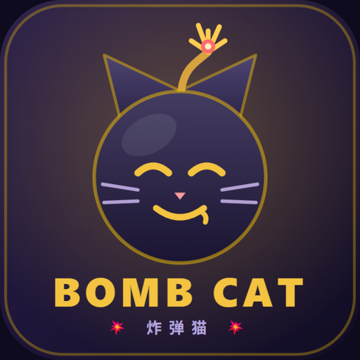

<p align="center"></p>

# 💥 BombCat

**English** | [简体中文](./README.md)

<p align="center">
  <b>Online multiplayer · 18 characters · world rules · custom decks — a web-based Exploding Kittens-style game, fully original</b>
</p>

A web-based Exploding Kittens–style party game with online multiplayer, deep customization, and an optional user system — fully original implementation.

> Game rules are not copyrightable; this project uses none of the official artwork or copy. The name and all card art are original/custom.

## Features

- **Online multiplayer**: 2–8 players, room codes, auto-reconnect within 60s (refresh-safe); fill empty seats with bots up to N players
- **Full rules + two expansions**: Attack / Skip / Favor / Shuffle / See the Future / Nope (8s window, counter-Nope) / Defuse with chosen insert position / streak stacking
  - **Imploding expansion**: Reverse ↩️ / Alter the Future 🔭 / Draw from the Bottom 🕳️ / Feral cat (wildcard combos) 🐈‍⬛
  - **Streaking expansion**: Streaking Cat 🐱‍💨 — secretly keep an exploding card in hand (cannot win while holding it; drawing a second one detonates)
- **18 characters**: 7 classics + 11 deeply custom ones, each with unique mechanics (see the in-game codex or [docs/CUSTOM_CHARACTERS.md](docs/CUSTOM_CHARACTERS.md))
  - **Classics**: Echo Mage, Oracle, Iron Knight, Phantom Thief, Alchemist, Lucky Cat
  - **Voyage**: swap 3 cards with a chosen player — your 3 are hand-picked, theirs are random
  - **Nana**: starts without a Defuse; on death becomes a Tear card; 3 Tears = permanent death
  - **Banana Queen**: "Banana Rage" masks and shuffles everyone's hands for a full round (blind plays only); 2 bananas = any action card, 4 = a Defuse
  - **Pig King**: extra draws + devour cards into digestion + "full" mechanic
  - **Chaos Queen**: ripple passive + reverse order + Chaos Touch (all draws become steals)
  - **Future Queen**: double See-the-Future at start + Fate Rewrite (peek 5, activate one, replace, rearrange)
  - **Big-Eye Nana**: dossiers on every functional card played → Expose (peek / force discard / steal); cannot Favor or steal
  - **Math Teacher**: add (target draws 1) / subtract (next draw −1) / multiply (next card triggers twice) / divide (next card fizzles), independent cooldowns
  - **Xiuying**: starts Frozen (10 stacks, immune to skills); thaw via help / being hit by skills & cards; feed lychees — 2 lychees grant a random cat
  - **Evil Apple Head**: hides an "Exploding Apple" in the deck (a bomb for others; she puts it back and draws); throws apples — targets may eat one (give a card) or it becomes another Exploding Apple after 3 turns
  - **Butcher**: gains "Bone" stacks whenever someone's cards are taken by another player; spends 3 to lock a player (no skills or action cards until the end of their next turn) and steal a card — steals and attacks against the locked player are doubled
- **6 world rules**: drawn each game, never twice in a row — Mad Draw 🌀 / Double Down 🎰 / Pass the Joy 🎁 / Defuse Galore 🔧 / Overdrive ⚡ / All-Seeing Eye 👁️
- **AI bots**: heuristic scoring AI (probabilistic beliefs, no cheating), aware of special mechanics (banana exchange, eating apples, help-thaw); practice mode with one click; quick match fills bots after 15s
- **Deck share codes**: export custom decks as `BM1.xxxx` short codes
- **Deep customization**: 📷 photo card skins (compressed in-browser) + 🃏 custom cards (13 effect primitives, server-validated)
- **Table presentation**: center stage "who played what → 🎯 whom", gold pulse on targeted seats, Hearthstone-style hand fan, scattered discard pile, explosion shake + particles, turn timer (45s auto-action), emotes, WebAudio SFX, 2x animation speed
- **One-click public play**: `scripts/cloudflare-pages.ps1` hosts the client on Cloudflare Pages (fixed URL) with the backend on this machine via a tunnel; `scripts/cloudflare-dev.ps1` is the tunnel-only mode (dev/prod)
- **Bilingual (中文 / English)**: UI, cards, characters and game logs; follows the browser language with a 中 / EN toggle; every player in a room sees their own language
- **Mobile friendly**: portrait layout, ≥40px touch targets, responsive card scaling
- **User system**: optional Supabase (email auth / cloud decks & skins / stats); **fully playable as guest without any setup**
- **Anti-cheat architecture**: authoritative server; hands never enter synced state, private info is sent point-to-point

## Tech Stack

| Layer | Tech | Notes |
|---|---|---|
| Game server | [Colyseus](https://github.com/colyseus/colyseus) 0.18 | One Room = one game; built-in reconnect |
| State sync | @colyseus/schema | Incremental public state; hidden info via private messages |
| Rules engine | Custom pure TS (`server/src/engine`) | Colyseus-free; seedable RNG for testability |
| Client | React 19 + Vite + motion | SPA; motion drives deal/play/reorder animations |
| Client SDK | @colyseus/sdk 0.18 | Version-paired with the server |
| User system | Supabase (optional) | Auth + Postgres + Storage; zero-config guest mode |
| Public play | Cloudflare quick tunnel | One-click dev exposure (http2 protocol) |

```
bombcat/
├─ shared/     Shared types, builtin cards/characters, anti-cheat validation (tested)
├─ server/     Colyseus Room + pure rules engine + AI BotBrain + JWT auth (unit + integration tests)
├─ client/     React SPA: login / lobby / room / table / workshop
├─ supabase/   SQL schema + RLS + storage bucket + setup guide
├─ scripts/    One-click public tunnel script + smoke/multiplayer verification
└─ docs/       Custom character design doc
```

## Getting Started (local dev)

Requires Node ≥ 20 and npm ≥ 10.

```bash
npm install        # install all workspace dependencies
npm run dev        # start game server :2567 + web client :5173 together
```

Open http://localhost:5173 — enter a nickname → create a room → share the 4-letter room code.
(Same-machine testing: open a second tab; identities are per-tab.)

More commands:

```bash
npm test           # all tests (shared validation + engine/characters + room integration — 110 tests)
npm run typecheck  # typecheck across the three packages
npm run build      # production build
```

### LAN play

The dev server listens on all interfaces (`host: true`). Friends can open `http://<your-LAN-IP>:5173`;
the client derives the game server address from the page hostname (`ws://IP:2567`).

### Public play via Cloudflare tunnels (one click)

```powershell
powershell -ExecutionPolicy Bypass -File scripts\cloudflare-dev.ps1           # dev mode
powershell -ExecutionPolicy Bypass -File scripts\cloudflare-dev.ps1 -Mode prod # production build + preview (smoother)
```

The script starts the server and client, opens two Cloudflare quick tunnels, bakes the backend
wss URL into the client config, and prints the shareable frontend URL. Quick-tunnel URLs change
on every restart.

### Public deploy (Cloudflare Pages client + local backend, recommended)

The client lives on Cloudflare Pages at a fixed URL (`https://bombcat.pages.dev`); the backend runs on this machine behind a quick tunnel.

```powershell
npx wrangler login                                                       # first time: log in to Cloudflare
powershell -ExecutionPolicy Bypass -File scripts\cloudflare-pages.ps1          # backend + tunnel + deploy
powershell -ExecutionPolicy Bypass -File scripts\cloudflare-pages.ps1 -Rebuild # rebuild after client changes
```

The client reads the backend URL from `/config.json` at startup. The tunnel URL changes on every restart, but the
script only redeploys that one file, so the link you share never changes.

### Supabase (optional)

See [supabase/README.md](supabase/README.md). Adds email auth, cloud decks/skins and stats;
the server then validates Supabase JWTs. Without it, guest mode is fully playable.

## Deployment

**Recommended: one-click Railway deploy.** The game server also serves the client, so the whole game lives at one URL. On railway.com sign in with GitHub → New Project → Deploy from GitHub repo → pick this repo → then Settings → Networking → Generate Domain. Build/start/health-check settings are in `railway.json`; every push redeploys automatically.

Other setups:

| Component | Suggested | Notes |
|---|---|---|
| Client | Vercel / any static host | `npm run build -w @bombcat/client` is pure static; set `VITE_GAME_URL` |
| Game server | Railway / any VPS / home PC + tunnel | Long-lived WebSocket process: `tsx src/index.ts`; set `VITE_GAME_URL=wss://your-domain` |
| Supabase | Free tier | See supabase/README.md |

> ⚠️ The game server cannot run on Vercel/Netlify serverless — no long-lived WebSockets there.

## Tests

```bash
npm test           # 110 tests (shared 8 + server 102)
npm run e2e        # Playwright end-to-end suites
```

- `shared/test/validation.test.ts` — deck/custom-card/skill validation (anti-cheat edges)
- `server/test/engine.test.ts` — rules engine: deal composition, skip/attack/streak stacking, alternating Nope window, pair/triple steals, explosion/defuse placement, deaths & win check, character skills, custom decks
- `server/test/v2-characters.test.ts` — all ten custom characters (round-based banana overlay, semantic math doubling, freeze/help/lychee, exploding apples, throws, help flow, log sanitization)
- `server/test/butcher.test.ts` — Butcher: stack gain, lock scope & expiry, per-target cooldown, doubled steals/attacks, freeze immunity, full AI game
- `server/test/room.integration.test.ts` — real server + SDK client: create/join/start/play through gameEnd
- `server/test/bot.test.ts` — AI bots playing full games to gameEnd

## Design Notes

- **Data-driven cards**: a card is JSON (id/name/emoji/effect primitives); custom cards may only compose
  bounded primitives and are double-validated by `validateDeck`; exploding/apple/defuse counts are rule-locked.
- **Hidden info never enters synced state**: hands sync as a count only; stolen card names, defuse
  positions and digestion contents are sanitized out of public logs.
- **Bounded, extensible skill framework**: a character skill is data (trigger + effect primitive +
  cooldown/uses); the engine resolves primitives — new characters plug in via
  [docs/CUSTOM_CHARACTERS.md](docs/CUSTOM_CHARACTERS.md).
- **Engine decoupled from transport**: `GameEngine` is pure input→events, unit-testable and portable.
- **Performance**: no page-wide polling timers (countdowns are self-ticking leaf components), stable
  discard-pile keys, 100ms incremental public state sync.

## Acknowledgements

Rules implementation references design ideas from several open-source Exploding Kittens clones
(ekittens, wwwcats, eggsplode…); all code in this project is original. Animations powered by
[motion](https://motion.dev/).
