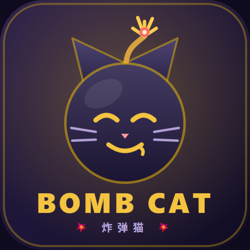

<p align="center"></p>

# 💥 炸弹猫 BombCat

[English](./README.en.md) | **简体中文**

<p align="center">
  <b>联机对战 · 18 位角色 · 全局规则 · 自定义卡组 —— 网页版炸弹猫，全部原创实现</b>
</p>

联机 + 深度定制 + 用户系统的网页版炸弹猫（Exploding Kittens 规则复刻，全部原创实现）。

> 规则本身不受版权保护；本项目未使用任何官方美术与文案，游戏名与卡面均为原创/自定义。

## 功能

- **联机对战**：2-8 人房间制实时对局，4 位房间码邀请；断线 60 秒内自动重连（刷新页面也不丢）；人不足可一键「补机器人至 N 人」
- **完整规则 + 两套扩展**：攻击/跳过/求赠/洗牌/预知未来/否认（8 秒窗口、可叠加反否认）/拆解自选放回位置/连击叠加
  - **内爆扩展**：反转 ↩️ / 改变未来 🔭 / 摸牌底 🕳️ / 万能猫（feral 通配组合）🐈‍⬛
  - **果奔扩展**：果奔猫 🐱‍💨——把爆炸猫秘密藏进手牌（持有期间无法获胜、双爆判负的诈唬博弈）
- **18 个角色**：7 个经典角色 + 11 个深度定制角色，每个都有独立机制（详见游戏内角色图鉴 / [docs/CUSTOM_CHARACTERS.md](docs/CUSTOM_CHARACTERS.md)）
  - **经典**：回响法师、预言家、铁壁骑士、怪盗基德、炼金术士、幸运绒球
  - **远航船长 Voyage**：与指定玩家换牌——自己出 3 张自选、对方随机 3 张
  - **Nana**：开局无拆解，死亡化作眼泪牌，集齐 3 张眼泪永久消逝
  - **香蕉女王 Banana**：大香蕉之怒全场手牌变香蕉并洗乱（覆盖一轮，全场只能盲打）；2 张香蕉=任意技能牌、4 张=拆解
  - **猪王 Pig King**：暴食多摸 + 吞噬消化对手手牌 + 饱腹机制
  - **混沌女王**：涟漪被动 + 反转顺序 + 混沌之触（全场摸牌变夺取）
  - **Future女王**：开局双预知 + 命运改写（看顶 5 张，激活一张 + 手牌替换 + 自由重排）
  - **大眼Nana**：监视全场积累档案 → 揭发（看牌/指定弃牌/抽牌），禁用求赠与偷牌
  - **数学老师**：四则运算——加（目标摸 1）、减（下次摸牌-1）、乘（下张功能牌触发两次）、除（下张功能牌无效），独立冷却
  - **秀英**：开局 10 层冰冻（不受技能影响），靠求助/被技能/被功能牌命中减层；解冻后喂荔枝，集齐 2 颗送随机普通猫
  - **邪恶苹果头**：开局往牌堆藏「爆炸苹果」（别人摸到等同爆炸猫，自己摸到悄悄放回再摸一张）；投掷邪恶苹果——目标可在自己回合吃掉（交一张手牌），否则 3 回合后变成爆炸苹果混入牌堆
  - **屠夫**：别人的手牌被拿走时攒「剔骨」层数；消耗 3 层封锁一名玩家（不能用技能和功能牌直到其下一回合结束）并抽走一张牌，封锁期间对他偷牌/攻击翻倍
- **6 条全局规则**：每局随机抽取且连续两局不重复——疯狂抽卡 🌀 / 双倍下注 🎰 / 传递快乐 🎁 / 防爆过剩 🔧 / 火力全开 ⚡ / 全员天眼 👁️
- **AI 机器人**：规则打分 AI（概率信念决策、不作弊读牌），并适配特殊角色（香蕉兑换、吃苹果、求助解冻）；人机练习一键开局；快速匹配 15 秒凑不齐自动补 AI
- **卡组分享码**：自定义卡组导出为 `BM1.xxxx` 短码，好友粘贴即玩
- **深度定制**：📷 照片卡面皮肤包（浏览器端压缩）+ 🃏 自定义卡牌（13 种效果原语组合，服务端强校验）
- **牌桌演出**：中央出牌舞台「谁打了什么 → 🎯谁」、目标座位金色脉冲、炉石式手牌、散乱弃牌堆、爆炸震屏+粒子、回合计时（45s 超时自动行动）、表情系统、WebAudio 合成音效、2x 动画速度
- **公网联机一键脚本**：`scripts/cloudflare-pages.ps1` 前端托管在 Cloudflare Pages（固定网址），后端跑在本机 + 隧道；`scripts/cloudflare-dev.ps1` 则是纯隧道模式（dev/prod 双模式）
- **移动端适配**：竖屏布局、触摸目标 ≥40px、卡牌自适应缩放
- **用户系统**：可选 Supabase（邮箱登录/云端卡组与皮肤/战绩表），**不配置则以纯游客模式完整可玩**
- **防作弊架构**：权威服务器；手牌永不进同步状态，看牌等私密信息点对点下发

## 技术栈

| 层 | 技术 | 说明 |
|---|---|---|
| 游戏服务器 | [Colyseus](https://github.com/colyseus/colyseus) 0.18 | Room = 一局游戏；掉线重连内置 |
| 状态同步 | @colyseus/schema | 公开状态增量同步；隐藏信息走私密消息 |
| 规则引擎 | 自研纯 TS（`server/src/engine`） | 不依赖 Colyseus，可播种随机源保证可测性 |
| 前端 | React 19 + Vite + motion | SPA；motion 做发牌/出牌/手牌重排动画 |
| 客户端 SDK | @colyseus/sdk 0.18 | 与服务端版本配对 |
| 用户系统 | Supabase（可选） | Auth + Postgres + Storage；游客模式零配置降级 |
| 公网联机 | Cloudflare quick tunnel | 开发期一键暴露（http2 协议，国内更稳） |

```
bombcat/
├─ shared/     前后端共用：卡牌/角色/效果类型、内置数据、防作弊校验（含单测）
├─ server/     Colyseus Room + 纯逻辑规则引擎 + AI BotBrain + JWT 验证（单测 + 集成测试）
├─ client/     React SPA：登录/大厅/等待室/牌桌/定制工坊
├─ supabase/   建表 SQL + RLS + 存储桶 + 配置指南
├─ scripts/    公网联机一键脚本 + 冒烟/多人验证脚本
└─ docs/       自定义角色设计文档
```

## 快速开始（本地开发）

要求：Node ≥ 20，npm ≥ 10。

```bash
npm install        # 安装全部 workspace 依赖
npm run dev        # 同时启动：游戏服务器 :2567 + 前端 :5173
```

浏览器打开 http://localhost:5173 —— 输入昵称 → 创建房间 → 把 4 位房间码发给朋友
（同机测试：开第二个标签页即可，身份按标签页隔离）→ 房主开始游戏。

其他命令：

```bash
npm test           # 全部测试（shared 校验 + 引擎/角色 + 房间集成，共 110 项）
npm run typecheck  # 三个包的类型检查
npm run build      # 生产构建
```

### 局域网试玩

前端开发服务器默认监听所有网卡（`host: true`）。朋友访问 `http://你的局域网IP:5173`，
游戏服务器地址由前端按页面主机名自动推导（`ws://IP:2567`），同一局域网即可联机。

### 公网联机（Cloudflare 隧道，一键）

```powershell
powershell -ExecutionPolicy Bypass -File scripts\cloudflare-dev.ps1           # 开发模式
powershell -ExecutionPolicy Bypass -File scripts\cloudflare-dev.ps1 -Mode prod # 生产构建 + preview（更流畅）
```

脚本会自动：启动服务器与前端 → 开两条 Cloudflare quick tunnel → 把后端 wss 地址写入前端配置 →
打印「发给朋友」的前端地址。注意 quick tunnel 地址每次重启都会变。

### 公网部署（Cloudflare Pages 前端 + 本机后端，推荐）

前端放 Cloudflare Pages，网址固定（`https://bombcat.pages.dev`）；后端仍跑在本机，经 quick tunnel 暴露。

```powershell
npx wrangler login                                                       # 首次：登录 Cloudflare 账号
powershell -ExecutionPolicy Bypass -File scripts\cloudflare-pages.ps1          # 启动后端 + 隧道 + 部署
powershell -ExecutionPolicy Bypass -File scripts\cloudflare-pages.ps1 -Rebuild # 改了前端代码后重新构建
```

前端启动时读取 `/config.json` 里的后端地址。每次重启脚本，隧道地址都会变，但脚本只重新部署这一个文件，
所以朋友的链接一直不变。关掉本机的 node/cloudflared 进程后，前端还能打开，但连不上游戏服务器。

### Supabase（可选）

见 [supabase/README.md](supabase/README.md)。配置后获得：邮箱登录、云端卡组/皮肤同步、战绩表；
服务端启用 Supabase JWT 验证。不配置则纯游客模式完整可玩。

## 部署

| 组件 | 推荐 | 说明 |
|---|---|---|
| 前端 | Vercel / 任意静态托管 | `npm run build -w @bombcat/client` 产物为纯静态；设置 `VITE_GAME_URL` 指向游戏服务器 |
| 游戏服务器 | Railway / 任意 VPS / 家用电脑 + 内网穿透 | 长连接进程，`tsx src/index.ts` 直接跑；`VITE_GAME_URL=wss://你的域名` |
| Supabase | 免费层 | 见 supabase/README.md |

> ⚠️ 游戏服务器不能放 Vercel/Netlify serverless——WebSocket 长连接不受支持。

## 测试

```bash
npm test           # 110 项测试（shared 8 + server 102）
npm run e2e        # Playwright 端到端（双人联机全流程/人机练习/分享码回环/防篡改）
```

- `shared/test/validation.test.ts` —— 卡组/自定义卡/技能校验（防作弊边界）
- `server/test/engine.test.ts` —— 规则引擎：发牌构成、跳过/攻击/连击叠加、否认窗口交替、对子/三连偷牌、爆炸/拆解位置、阵亡与胜负、角色技能、自定义卡组
- `server/test/v2-characters.test.ts` —— 十个定制角色逐一覆盖（香蕉覆盖轮次制、四则运算双倍、冰冻/求助/荔枝、爆炸苹果、投掷、求助链路、信息脱敏等）
- `server/test/butcher.test.ts` —— 屠夫：剔骨计层、封锁范围与解除、按目标冷却、压制翻倍、冰冻免疫、AI 整局
- `server/test/room.integration.test.ts` —— 真实服务器 + SDK 客户端：建房/加入/开局/出牌/整局到 gameEnd
- `server/test/bot.test.ts` —— AI 机器人整局对弈到 gameEnd

## 设计要点

- **数据驱动卡牌**：卡 = JSON（id/名称/emoji/效果原语列表），自定义卡只能从有界原语组合，服务端
  `validateDeck` 双重校验；爆炸猫/爆炸苹果/拆解数量由规则锁定不可定制。
- **隐藏信息不进同步状态**：手牌只同步 handCount，本人手牌由房间层私发；偷到的卡名、拆解位置、
  消化中的卡等一律脱敏（公开日志不泄露）。
- **技能框架有界可扩展**：角色技能 = 数据（trigger + effect 原型 + 冷却/次数），引擎按原型结算；
  新角色照 [docs/CUSTOM_CHARACTERS.md](docs/CUSTOM_CHARACTERS.md) 填 JSON + 实现原型即可接入。
- **引擎与传输解耦**：`GameEngine` 是纯函数式输入输出（返回事件数组），可独立单测、可移植。
- **性能**：无整页轮询定时器（倒计时为自计时叶子组件）、弃牌堆稳定 key、公开状态 100ms 增量同步。

## 致谢

规则实现参考了开源社区的多个 Exploding Kittens 复刻项目（ekittens、wwwcats、eggsplode 等）的
设计思路，全部代码为本项目原创。动画由 [motion](https://motion.dev/) 驱动。
